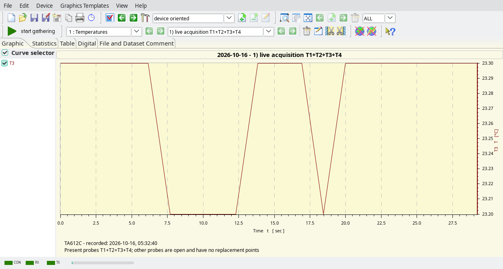
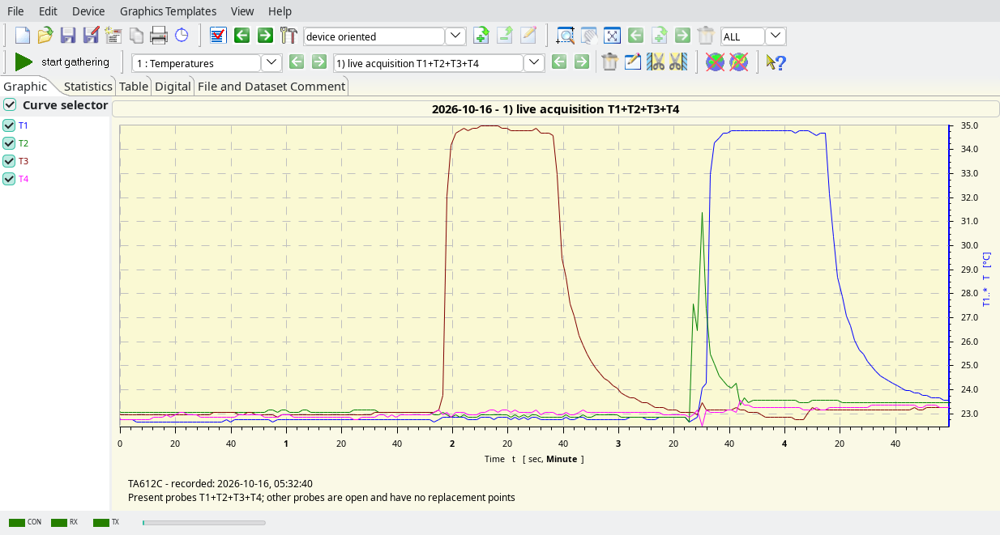

# Four reproduced GUI findings in beta 3

These observations concern the build identified in the [test report](README.md).
Codex operated DataExplorer, inspected native state and saved files, and wrote
this report. The operator handled the physical meter and probes and personally
clicked the REC menu in the final menu test. The [source analysis](SOURCE_ANALYSIS.md)
is separate, so the reproductions can be assessed without its explanations.

The fourth finding was added after a saved-file follow-up on the same day.
Codex performed that follow-up without a new physical acquisition, using the
unchanged distributed beta and an isolated profile.

## REC menu does not open after an OSD is opened

**Effect:** the REC interval dialog becomes inaccessible in the same application
process even though its import menu item remains enabled. No error is displayed.

Reproduced sequence:

1. Start DataExplorer with TA612C selected and acquisition stopped.
2. Select **File > Import > Download TA612C REC memory... / Cancel REC**.
   The interval dialog opens with a blank interval field.
3. Cancel the dialog. Open `2026-10-16-REC-T2-T4-beta3.osd` from the evidence
   archive through the native File > Open action.
4. Select the same REC menu item again.

Expected: the same interval dialog opens. Observed: no interval dialog or alert;
the saved REC graph remains visible. The native UI inspection found the menu
enabled and serial closed. The operator performed both menu selections and
reported the second failure; Codex verified the resulting UI. No download was
submitted in this sequence. Fresh startup restored access in the observed tests.
A cancellation-only experiment was not performed.

Dialog after fresh startup:

Application after the unsuccessful post-OSD menu selection:

The second static image alone cannot prove the menu click occurred; that part
comes from the operator's report and subsequent Codex UI inspection.

## Table headers do not follow the active probes

**Effect:** correct values can appear beneath another probe's name, and a valid
probe may have no visible column. This can misidentify a measurement when reading
the table. The checked OSD records retain the correct physical channel mapping.

Live reproduction, also repeated after restarting DataExplorer:

1. Connect only T2 and T4; leave T1 and T3 empty.
2. Open `2026-10-16-T1-beta3.osd` and select Table, showing Time/T1.
3. Select File > New, start TA612C live acquisition, then inspect Table.
4. Stop and save. Open that saved OSD through File > Open and inspect Table again.

Expected: the new live table identifies T2 and T4. Observed before saving:
Time/T1 headers remain, T2 values appear under T1, and no T4 column is present.
The native reopened table correctly identifies T2/T4, with matching values
and displayed times. The repeated test's saved output is
`2026-10-16-restart-retest-beta3.osd`.

Related reproduced cases:

- A fresh T2/T4 REC import retained Time/T1/T2/T3/T4 headers. T2 values appeared
  under T1 and T4 values under T2; the remaining columns were empty. Reopen
  restored Time/T2/T4. Use the archive's REC file to inspect the stored mapping;
  reproducing the pre-save state requires the native REC import with a known
  recording interval (5 seconds in this test).
- During the all-probes-absent test, the new T3-only segment retained the older
  table labels, displaying T3 values under T1. All four probes together appeared
  correctly because the four existing headers matched that configuration.

The supplied table JSON preserves the actual headers and rows, including the
misleading captures. Codex's comparisons do not relabel columns to make them
pass. Some captured windows have narrow time columns; the JSON retains their
full displayed text. Images are unchanged captures, not reconstructed tables.

## A later segment has a line before its first stored sample

**Effect:** a graph shows a temperature over an earlier period for which that
segment has no recorded data. This can suggest continued measurement during
probe absence. The extra line is not present as points in the OSD payload.

Reproduction using the saved file, without a connected meter:

1. Open `2026-10-16-all-probes-absent-T3-return-beta3.osd`.
2. Select record set **3) live acquisition T3** in the normal, unzoomed Graphic
   view.
3. Compare the left part of the curve with the first row in Table.

Expected: the curve starts with the first stored T3 sample at 53.8227 s,
22.6 °C. Observed: a horizontal 22.6 °C line extends from zero to that first
sample, along the lower plot border in this capture. The native table begins at
53.822 s (millisecond display); the OSD retains 53.8227 s. The segment contains
51 samples and no earlier point.

The same behavior appeared in the second and third sets of
`2026-10-16-T4-disconnect-reconnect-beta3.osd`, whose first stored times are
21.4947 s and 35.3271 s. Each segment retains its position on the acquisition's
shared elapsed-time axis. Zoom, scope, comparison and GPS views were not tested
for this finding.

## Graphic retains the previous file after returning from Table

**Effect:** the title and comment can describe the newly opened file while the
curve, axes and curve-selector list still show the previous file. The new data
is already loaded, so the visible graph can misidentify the measurement being
displayed.

Reproduction using two files already in the evidence archive, without starting
meter acquisition:

1. Start the unchanged beta with TA612C selected. On Graphic, open
   `2026-10-16-USB-recovery-T3-beta3.osd`. It contains 20 T3 rows over 29.2268 s,
   ranging from 23.2 to 23.3 °C.
2. Click Table, then use File > Open to open
   `2026-10-16-T1-T2-T3-T4-beta3.osd`. It contains 196 rows over 299.1568 s.
3. Press **Ctrl+PageUp twice** to return to Graphic through Statistics.

Expected: the graph and selector display T1–T4 from the second file. Observed:
the approximately 30-second T3-only curve and selector remain, although the
record-set title and comment now identify the four-probe data. Returning through
**View > previous tabulator** also reproduced the failure; that menu sequence
visited Digital before returning. The native Table had Time and T1–T4 columns
with 196 rows, and Digital showed the current four-probe set.

**Verified workaround:** click Statistics and then Graphic with the pointer.
Both the curve image and selector refresh. Directly clicking Graphic after
opening the second file from Table also worked. A restart was not required.

Codex compared twelve snapshots of the unmodified beta. While the curve was
stale, the second file's loaded values and timestamps were identical to those
after pointer recovery. The graph's cached pixel hash still matched the first
file exactly. Pointer recovery replaced the image and restored T1–T4 in the
selector. [The snapshot extracts](verification/graphic-refresh.json) retain
these checks and the native table. This observed mismatch concerns presentation;
no loaded-data loss or alteration was found in the reproduction.

This follow-up used Linux GTK3/X11 on a 1280×720, 96-DPI virtual display. Native
menu actions, pointer clicks and keyboard events performed navigation; a
read-only inspection agent captured the model and cache on the SWT thread.
It did not change selection, redraw the graph or modify measurement data.
Other devices, platforms and graph modes were not tested. Native Ctrl+PageDown
return to Graphic was not separately tested. No application fix is included.

## Supporting interruption result

The USB test is included as a successful recovery observation. The operator
reported simultaneous meter power loss on unplugging USB.
DataExplorer retained the collected T3 values and displayed this notice:

After USB and power were restored, an explicit new Start worked in the same
application process. The [report](README.md) records the scope and sample counts.
